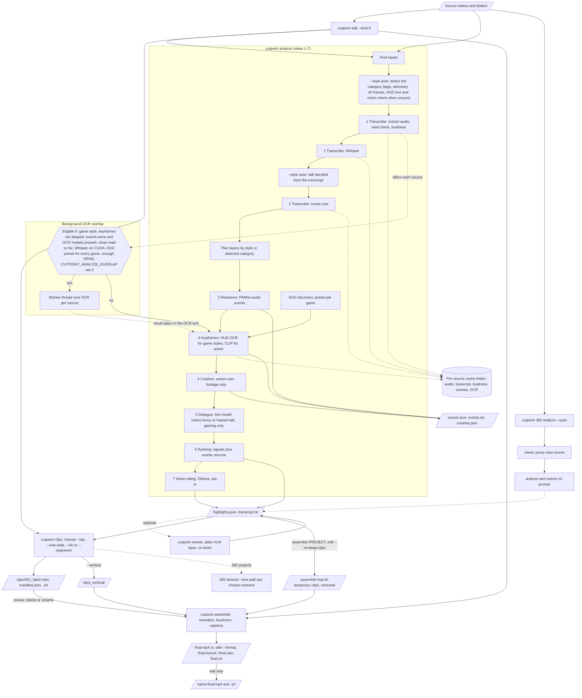
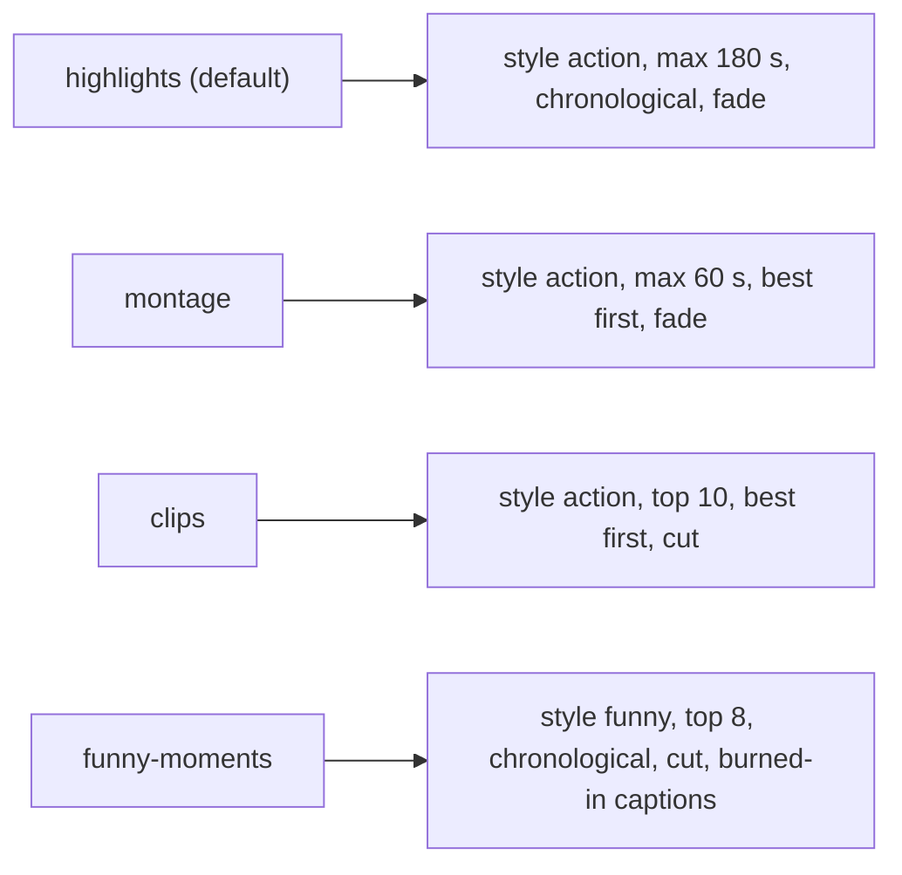
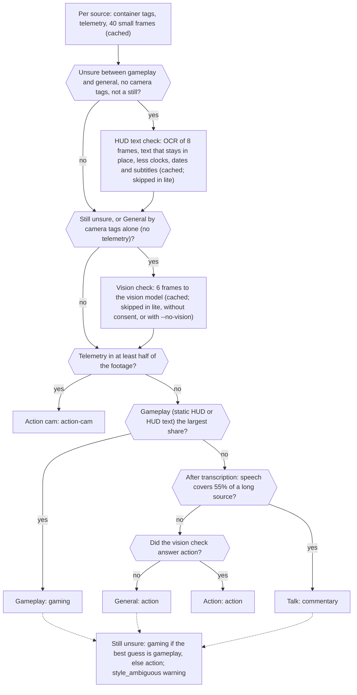

# Pipeline

Cutpoint reads source videos (never modifying them), finds the best moments, exports them as
numbered clips and joins them into a final video. `cutpoint edit` runs the whole chain in one
process; the same stages are available as `analyze`, `events`, `clips` and `assemble`.
[Architecture](architecture.md) covers the modules behind each stage.

## Main flow

## Kind presets (`cutpoint edit --kind`)

All kinds also set loudnorm on. `--style`, `--top` and `--max-total` override the kind.
`--style auto` picks the style from the footage before the `--events` check (the funny style for
`funny-moments`); unclear footage gets `gaming` when its best guess is gameplay, else the General style (`action`; `funny` for `funny-moments`).

## Style auto (`--style auto`, `cutpoint detect`)

One category per project, by the share of the footage duration (sources of another category
over 10% of it: `style_sources_disagree`). The HUD text check only lifts an unsure source to
sure gameplay; it does not make camera-tagged footage or a still picture gameplay. In `analyze`'s own steps the detected category, not
the style, plans the HUD OCR and CLIP layers, so `funny` on camera footage gets the CLIP layer,
not the HUD OCR. `edit --events` and `cutpoint events` still choose their layers by style.
`funny-moments` maps every category to `funny`. `highlights.json` records the result; `events`
and re-runs reuse it.

## Legend

- Parallelogram: input or output files and folders (project files).
- Cylinder: per-source cache, keyed by path, size and modification time.
- Hexagon: eligibility decision for the background OCR.
- Solid arrow: normal flow. Dotted arrow: cache writes, optional or background paths.
- Numbers 1-7 are the analyze progress steps: transcribe, reactions, keyframes, crashes, dialogue,
  ranking, vision.
