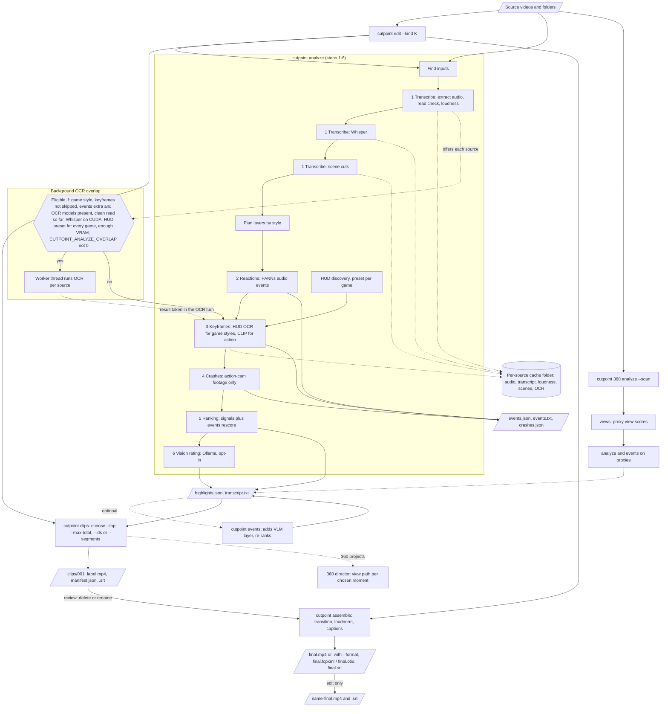
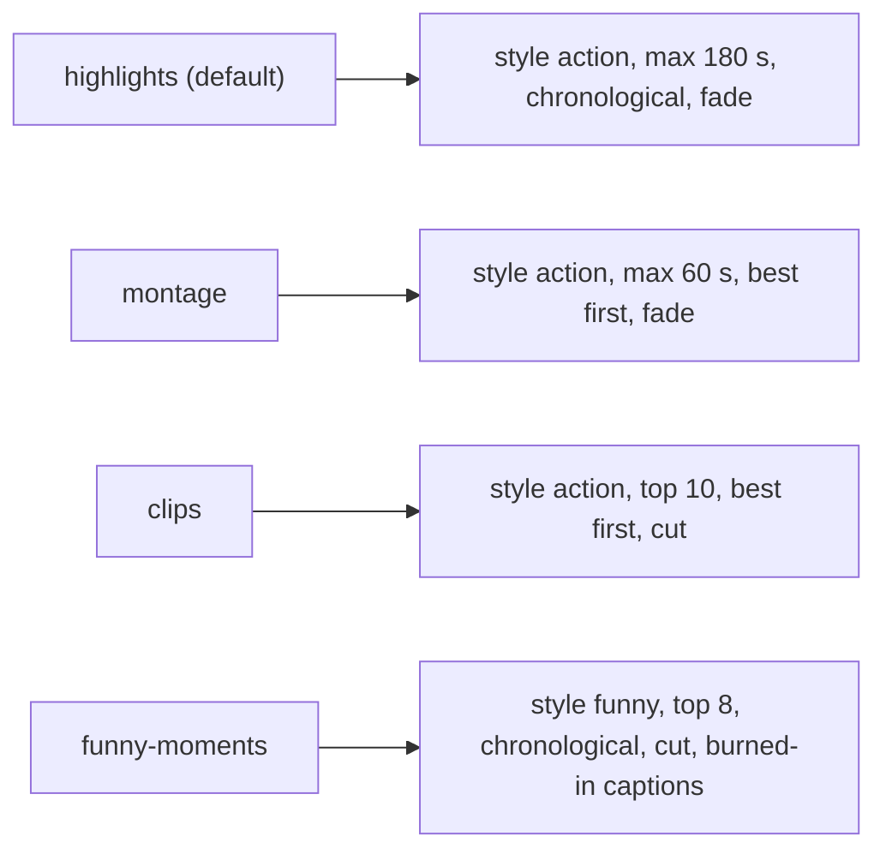

# Pipeline

Cutpoint reads source videos (never modifying them), finds the best moments, exports them as
numbered clips and joins them into a final video. `cutpoint edit` runs the whole chain in one
process; the same stages are available as `analyze`, `events`, `clips` and `assemble`.
[Architecture](architecture.md) covers the modules behind each stage.

## Main flow

## Kind presets (`cutpoint edit --kind`)

All kinds also set loudnorm on. `--style`, `--top` and `--max-total` override the kind.

## Legend

- Parallelogram: input or output files and folders (project files).
- Cylinder: per-source cache, keyed by path, size and modification time.
- Hexagon: eligibility decision for the background OCR.
- Solid arrow: normal flow. Dotted arrow: cache writes, optional or background paths.
- Numbers 1-6 are the analyze progress steps: transcribe, reactions, keyframes, crashes, ranking,
  vision.
