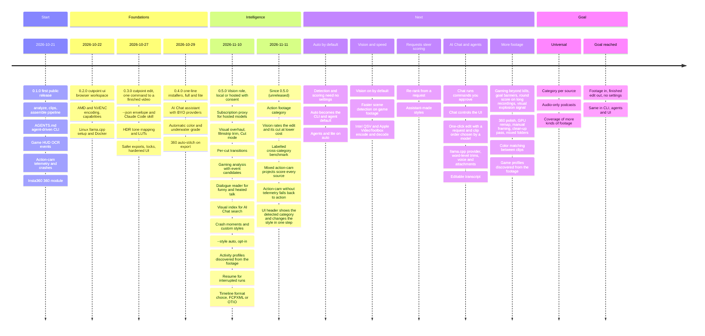

# Roadmap

Cutpoint is meant to be a universal AI footage editor: you give it footage and nothing else, it
detects what is in the video and scores the moments from that. Settings such as the style are
overrides, and what you ask for, such as funny moments or a length, steers the result. The
diagram shows what has shipped, what comes next and where Cutpoint is
going.

Issues behind the Next bands:

- Auto by default: [#901](https://github.com/FerventOrange/cutpoint/issues/901) (agents and CLI on auto), [#904](https://github.com/FerventOrange/cutpoint/issues/904) (lite), [#899](https://github.com/FerventOrange/cutpoint/issues/899) (zero-config acceptance test).
- Vision and speed: [#907](https://github.com/FerventOrange/cutpoint/issues/907), [#893](https://github.com/FerventOrange/cutpoint/issues/893) (vision on by default), [#730](https://github.com/FerventOrange/cutpoint/issues/730) (scene detection), [#448](https://github.com/FerventOrange/cutpoint/issues/448) (QSV and VideoToolbox).
- AI Chat and agents: [#706](https://github.com/FerventOrange/cutpoint/issues/706) (Chat runs commands, controls the UI), [#708](https://github.com/FerventOrange/cutpoint/issues/708) (llama.cpp provider, word-level trims, voice, attachments), [#260](https://github.com/FerventOrange/cutpoint/issues/260) (editable transcript), [#2](https://github.com/FerventOrange/cutpoint/issues/2) (one-click edit: `edit --context`, model-chosen clip order).
- More footage: [#800](https://github.com/FerventOrange/cutpoint/issues/800), [#872](https://github.com/FerventOrange/cutpoint/issues/872), [#874](https://github.com/FerventOrange/cutpoint/issues/874) (gaming), [#10](https://github.com/FerventOrange/cutpoint/issues/10), [#345](https://github.com/FerventOrange/cutpoint/issues/345), [#344](https://github.com/FerventOrange/cutpoint/issues/344), [#341](https://github.com/FerventOrange/cutpoint/issues/341) (360), [#290](https://github.com/FerventOrange/cutpoint/issues/290) (color matching), [#8](https://github.com/FerventOrange/cutpoint/issues/8) (game profiles discovered from the footage).

This page is updated at each release. The [CHANGELOG](https://github.com/FerventOrange/cutpoint/blob/main/CHANGELOG.md) has the details.
