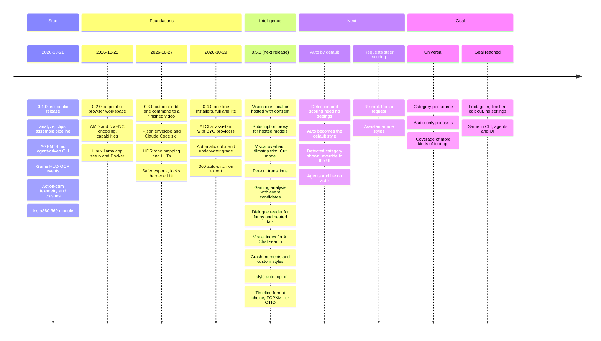

# Roadmap

Cutpoint is meant to be a universal AI footage editor: you give it footage and nothing else, it
detects what is in the video and scores the moments from that. Settings such as the style are
overrides, and what you ask for, such as funny moments or a length, steers the result. The
diagram shows what has shipped, what is on `main` for the next release and where Cutpoint is
going.

This page is updated at each release. The [CHANGELOG](https://github.com/FerventOrange/cutpoint/blob/main/CHANGELOG.md) has the details.
